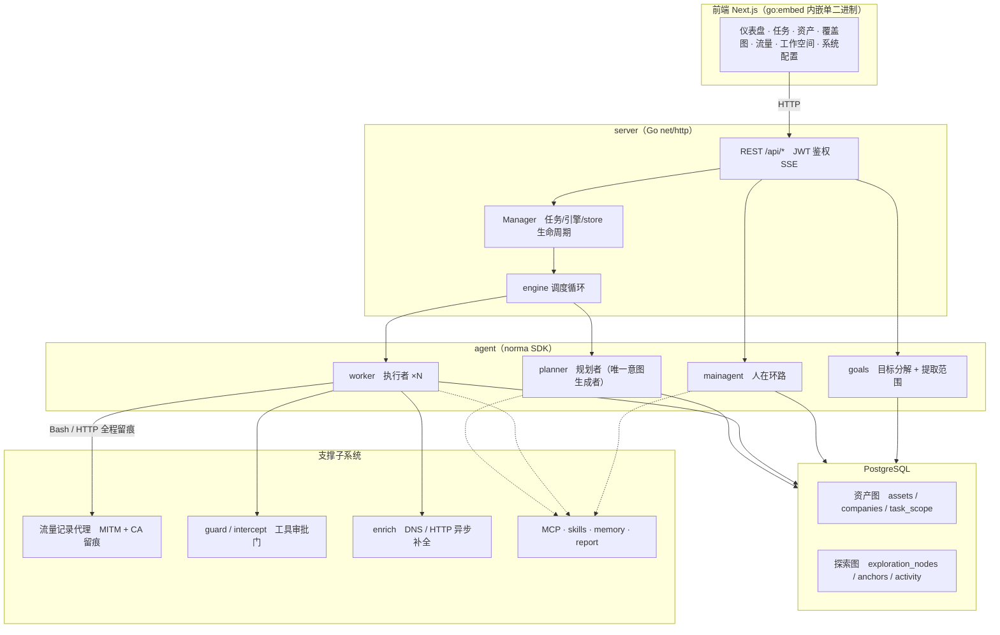
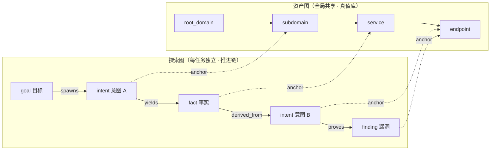
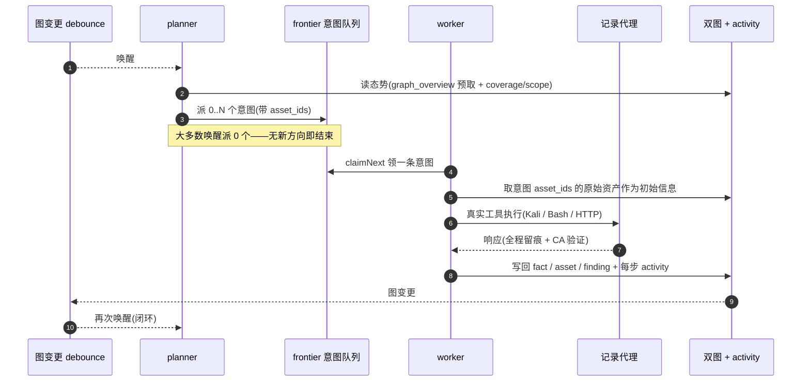
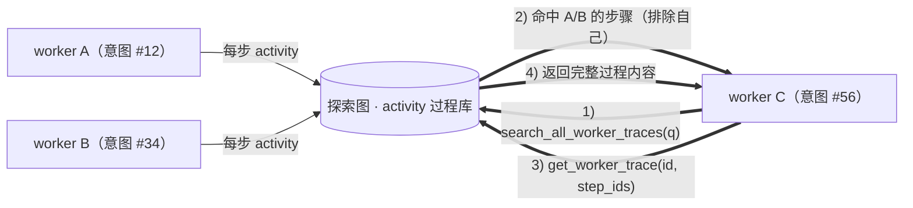
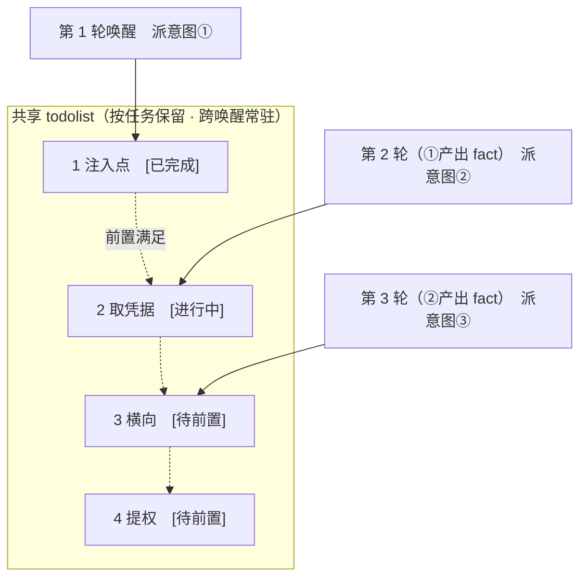

<div align="center">

# 0x

AI 自主渗透测试系统（Go 后端 + Next.js 前端）


🌐 **在线 Demo（上游）**： [https://artex-demo-ruoji6.vercel.app/](https://artex-demo-ruoji6.vercel.app/)

</div>

本仓库是 [RuoJi6/ARTEX](https://github.com/RuoJi6/ARTEX) 的二次开发分支（fork），保留上游的原始提交历史与 **AGPL-3.0** 许可证。相对上游的主要改动是**改名与共存适配**：程序名、镜像、环境变量、端口、Cookie、数据卷全部换成 0x 自己的标识，因此可以和原版 ARTEX 部署在同一台机器上互不干扰。

- 程序发布包：本仓库 [Releases](https://github.com/kismetpro/0x/releases)
- 容器镜像：[ghcr.io/kismetpro/0x](https://github.com/kismetpro/0x/pkgs/container/0x)（本仓库 GitHub Actions 构建发布）；若维护者配置了 Docker Hub 凭据，同一版本会同时推送到 [kismetpro/0x](https://hub.docker.com/r/kismetpro/0x)
- 在线更新源：本仓库 Releases（不再指向原作者仓库）

> 下文截图与「在线 Demo」均来自上游界面，除品牌标识外与本仓库一致。

## 与原版 ARTEX 共存

0x 与原版 ARTEX 的标识、端口、状态全部错开，可以在同一台机器上同时部署、同时运行：

| 项目 | 原版 ARTEX | 0x |
| --- | --- | --- |
| 可执行文件 | `artex` / `artex.exe` | `0x` / `0x.exe` |
| 环境变量前缀 | `ARTEX_` | `ZEROX_`（`0X_` 不是合法 shell 变量名，故展开为 `ZEROX_`） |
| 界面 / API 端口 | 8787 | **9887** |
| 流量录制代理端口 | 8788 | **9888** |
| 登录 Cookie | `artex_token` / `artex_basic_auth` | `zerox_token` / `zerox_basic_auth` |
| 容器镜像 | `ruoji6/artex` | `ghcr.io/kismetpro/0x`（可选同步 Docker Hub `kismetpro/0x`） |
| Compose 工程 / 容器 | `artex` | `0x`（容器 `0x`、`0x-postgres`） |
| Postgres 数据卷 | `pgdata` | `0x-pgdata` |
| Postgres 角色 / 库 | `artex` | `zerox` |
| 本地 Postgres 宿主端口 | 5432 | 5433 |
| 在线更新源 | `RuoJi6/ARTEX` | `kismetpro/0x` |
| 一键更新中间产物 | `artex.new` / `artex.old` / `artex.upgrade.json` | `0x.new` / `0x.old` / `0x.upgrade.json` |

注意事项：

- **Cookie 必须区分**：浏览器不区分端口，`localhost:8787` 与 `localhost:9887` 共用同一 Cookie 域；两套系统 Cookie 名不同，才能同时登录而不互踢。
- **各自独立部署目录**：数据目录是「可执行文件同级的 `data/`」（`jwt.key`、任务工作区等），装在不同目录即可互不覆盖；也可用 `-data` 显式指定。
- **共用同一台 Postgres 服务器**时使用不同角色/库名（默认 `zerox`），不要与原版的 `artex` 库共用。
- **不要把 0x 指向原版正在使用的数据库和 data 目录**：两边的端口、Cookie、更新源都不同，混用会出现登录态互踢、在线更新互相覆盖等问题。
- 从原版**迁移**（而非并存）可以直接复用原库与原 `data/`：表结构与 `jwt.key` 兼容，登录用户名改为 `0x`，密码不变。

---

## 截图预览

> 以下截图为上游 ARTEX 的界面（本仓库仅品牌标识不同），完整交互见[上游在线 Demo](https://artex-demo-ruoji6.vercel.app/)。

| 仪表盘（总览 / Token 消耗 / 活动流） | 任务列表 |
| :---: | :---: |
|  |  |

| 任务 · 执行过程（会话 / 工具调用） | 探索链路 |
| :---: | :---: |
|  |  |

| 发现 | 资产 |
| :---: | :---: |
|  |  |

| 资产覆盖图（力导向布局 · 已测高亮 · 节点折叠展开） |
| :---: |
|  |

| 流量录制 | 人在环路对话 |
| :---: | :---: |
|  |  |

| Agent 管理 | LLM 配置 |
| :---: | :---: |
|  |  |

| 拦截审批 | 后端日志 |
| :---: | :---: |
|  |  |


---

## 审批记录详情

全局「审批记录」、任务内「拦截审批」及对话中的审批卡片均支持展开查看详情。展示结构参考
[AegisHook 的审批详情组件](https://github.com/RuoJi6/AegisHook/blob/main/web/src/components/CallDetail.vue)，沿用 0x 的组件和主题：


## 资产同步（ScopeSentry）

支持从 [ScopeSentry](https://github.com/Autumn-27/ScopeSentry) 直接同步资产数据，免去重复收集：

- 在「**资产同步**」页填 ScopeSentry 的地址与 API Key，接入数据源；
- 按**项目**或**任务**维度选择要同步的目标与资产类型（域名 / 子域 / IP / 端口 / 站点 / 端点…）；
- 一键导入并按公司资产范围归并，直接进入 0x 的资产图供 agent 探索使用。

---

## 部署自己的在线 Demo（随正式 Release 自动更新）

Demo 只运行 `web/` 前端，构建时启用 `NEXT_PUBLIC_MOCK=1`，不需要 Go、PostgreSQL 或模型密钥。界面使用模拟数据，不执行真实扫描。

发布链路：正式版本的程序包、`SHA256SUMS` 和 Docker 镜像全部成功发布 → `release.yml` 的 `demo` job 调用 `demo.yml` → 检出该版本标签的提交 → 构建 Mock 前端 → 部署至 Vercel 的固定生产域名。普通 main 推送、仅创建标签、失败的发布、草稿和预发布版本都不会更新 Demo。新版本功能的演示数据仍需由维护者同步维护 `web/src/lib/mock/`。

### 首次配置 Vercel

1. 在自己的 Vercel 账号创建空项目，设置名称（例如 `0x-demo`）。保持 **Git 未连接**，避免每次提交都自动部署。`web/vercel.json` 也禁用了 Git 自动部署。
2. 在 **Settings → Build and Deployment** 中选择 **Next.js**、Node.js **22.x**，安装命令可覆盖为 `npm ci`，构建命令为 `npm run build`，Output Directory 保持默认。**Root Directory 留空**：此工作流从检出的 `web/` 目录调用 Vercel CLI，不能再填一层 `web`。
3. 在项目的 **Environment Variables** 中添加 `NEXT_PUBLIC_MOCK=1`，至少应用于 **Production**。不要设置 `NEXT_EXPORT=1`，也不要填写数据库连接或模型密钥。
4. 在项目 **Settings → General** 复制 **Project ID**；在团队 **Settings → General** 复制 **Team ID**（对应 `VERCEL_ORG_ID`）。确认 **Domains** 中有准备使用的生产域名。
5. 在 Vercel **Account Settings → Tokens** 创建部署 Token，范围选择项目所在团队，并设置适当有效期。将其直接保存到 GitHub 仓库 **Settings → Secrets and variables → Actions → Secrets**，名称为 `VERCEL_TOKEN`。令牌不要写入仓库、README 或聊天；到期后更新这个 Secret。

在同一 GitHub 设置页的 **Variables** 中添加：

| 变量 | 值 |
| --- | --- |
| `VERCEL_ORG_ID` | Vercel Team ID |
| `VERCEL_PROJECT_ID` | Vercel Project ID |
| `DEMO_URL` | 固定公开生产网址，含 `https://`，例如 `https://0x-demo.vercel.app` |

### 首次部署与重试

将配置合并到默认分支后，打开 **Actions → deploy-demo → Run workflow**，分支选 `main`，tag 留空或填写当前最新正式版（例如 `v0.3.21`）。工作流只接受已发布且包含五个平台程序包和校验文件的最新正式版，也能部署尚未包含此工作流的历史正式版。无需重新发 Release 或移动已有标签。

工作流会将这个专用 Demo 项目的框架设为 Next.js、Node 设为 22.x、根目录设为空、安装命令设为 `npm ci`、构建命令设为 `npm run build`，并确保 Production 环境的 `NEXT_PUBLIC_MOCK=1`，随后绑定 `DEMO_URL` 指定的域名。请使用独立项目；后续部署会继续维护这些配置。

成功后访问生产域名，并检查 `/demo-version.json` 中的 `tag`、`commit` 和 `mock: true`。确认可访问后，将 README 顶部和截图区域的旧 Demo 链接一起改为自己的生产域名。

此后按正常流程发布更高版本即可自动更新 Demo。若 Demo 部署失败，已发布的程序包和镜像仍然有效，旧 Demo 通常继续提供服务；修复设置后单独重跑 `deploy-demo`，不必重新发布整个 Release。两个版本同时发布时，部署串行执行，并在构建前、上线前检查 latest，避免已过期的构建覆盖新版。

这里采用发布流程直接调用部署 job，是因为使用 `GITHUB_TOKEN` 创建的 Release 不会继续触发另一个 `release: published` 工作流。`demo.yml` 也监听网页手工发布的 Release，经过同样的正式版、完整发布包和 latest 检查后部署；手工重试则运行 `deploy-demo`。

---

## 安装

> 依赖数据库 **PostgreSQL**；探索需配置 **LLM**（`ANTHROPIC_API_KEY` 或 `OPENAI_API_KEY`，也可在 UI 里配）。

### 方式一：一键安装脚本（推荐）

```bash
git clone https://github.com/kismetpro/0x.git
cd 0x
./install.sh
```

脚本会：检测 / 自动安装 Docker → 让你选 **① 全部 Docker** 或 **② 本地编译运行**：

- **① 全部 Docker**：填一个 Postgres 密码（可回车随机）→ 自动写 `.env` → `docker compose up -d`。
- **② 本地运行**：选数据库（连已有 / 用 Docker 起一个）→ 生成 `config.json` → `go` 编译内嵌单二进制 → 启动。

装好后打开 **http://localhost:9887**（首次进入 `/setup` 设置管理员密码）。

### 方式二：Docker Compose（手动）

```bash
git clone https://github.com/kismetpro/0x.git
cd 0x
cp .env.example .env          # 填 POSTGRES_PASSWORD、可选 ANTHROPIC_API_KEY
docker compose up -d          # 拉取 ghcr.io/kismetpro/0x 镜像 + postgres
# → http://localhost:9887
```

镜像已含常用工具（ripgrep/curl/vim/npm/nmap…）；`./skills` 与 `./data` 以绑定挂载持久化。

`.env` 中默认 `ZEROX_IMAGE=ghcr.io/kismetpro/0x`，`ZEROX_TAG=latest` 使用最新镜像，也可固定为 `v0.3.17`（完整镜像地址 `ghcr.io/kismetpro/0x:v0.3.17`）。GHCR 上的镜像随公开仓库公开，拉取无需登录。镜像支持 `linux/amd64` 和 `linux/arm64`，Docker 会自动选择与宿主机匹配的架构，ARM64 Kali 无需自行编译。初次部署请修改 `POSTGRES_PASSWORD`；运行服务无需配置 Docker Hub 发布 Token。

远程 MCP 可在系统设置中选择 `http`（Streamable HTTP）或 `sse`（旧版 SSE）。
旧版 SSE 服务通常使用 `GET /sse` 建立事件流，再通过服务返回的
`/message?sessionId=...` 接收 JSON-RPC 请求；配置时将 URL 填为 `/sse`，请求头按
`Authorization=Bearer <token>` 填写。

### 方式三：下载预编译二进制（Releases）

到本仓库的 [Releases](https://github.com/kismetpro/0x/releases) 下载对应平台的 zip，解压后得到 `0x` + `start.sh`（Windows 为 `start.bat`）+ `skills/` + `config.example.json`。Linux ARM64（包括 ARM64 Kali）选择 `linux-arm64`，x86_64 选择 `linux-amd64`：

```bash
cp config.example.json config.json   # 填好 database 连接
./start.sh                           # → http://localhost:9887
```

> 请用 `start.sh` / `start.bat` 启动，而不是直接跑 `./0x`。它是个守护脚本：程序退出后按退出码决定是否重新拉起，**页面上的[一键更新](#方式一页面一键更新推荐)靠它完成换装**。直接运行 `./0x` 时更新完就不会被拉起了。
> 后台常驻：`nohup ./start.sh >0x.log 2>&1 &`。

### 方式四：从源码编译单二进制

```bash
# 1) 前端静态导出
cd web && npm ci && npm run build:static && cd ..
# 2) 拷进内嵌目录
cp -r web/out server/webui/dist
# 3) 编译（-tags embedui 才内嵌前端）
CGO_ENABLED=0 go build -tags embedui -o 0x ./cmd/0x
./start.sh
```

### 方式五：构建跨平台 Release 压缩包

`build.sh` 会先构建并嵌入前端，再使用 Go linker 去除调试信息，并将发布文件压缩为 zip。Release 模式默认生成 Linux amd64/arm64、macOS amd64/arm64 和 Windows amd64 的 zip 包：

```bash
./build.sh --release
# 产物：dist/0x-0.3.3-*.zip
```

UPX 自解压二进制可能与部分 Linux 内核、虚拟化环境或安全策略不兼容，因此默认不启用。可用 `ZEROX_TARGETS` 自定义目标；确认目标运行环境兼容时，可显式传入 `--upx` 进一步缩小二进制：

```bash
ZEROX_TARGETS=linux/amd64,windows/amd64 ./build.sh --release
./build.sh --target linux/amd64 --upx
```

---

## 更新升级

> 升级只换程序、不动数据：Postgres 数据卷 `0x-pgdata`、`./data`（jwt.key、任务工作区等）、`./skills` 都会保留。**数据库迁移无需手动执行**——`0x` 每次启动会幂等重跑 `schema.sql`（含 `ADD COLUMN` / `CREATE INDEX IF NOT EXISTS`），即“重启即迁移”。升级前仍建议先备份 `./data` 与数据库。

### 方式一：页面一键更新（推荐）

在 **系统配置** 页（侧边栏「系统配置」→ `/system/settings`）的**版本与更新**卡片里，可以直接检查并安装新版本，无需登录服务器。

本仓库构建的程序固定从 `kismetpro/0x` 的最新正式 GitHub Release 检查更新，跳过草稿和预发布版本。旧版官方程序仍指向原作者仓库，因此首次切换必须手动安装本仓库构建的程序；以后发布更高的三段式版本即可通过页面升级。仅推送 main 或 Git 标签但未发布 Release，不会产生可在线安装的新版本。

点「更新」后：下载当前平台的发布包 → 比对 Release 的 `SHA256SUMS` → 用 `-h` 冒烟测试新二进制 → 暂存为 `0x.new` → 程序退出，由 `start.sh` / `start.bat` 重新拉起并完成换装。页面会自动等到新版本上线后刷新。

- **失败不会留下坏程序**：校验或冒烟不通过就丢弃暂存件、继续跑当前版本；换装后的新版若连续 3 次启动失败，会自动回滚到 `0x.old`（失败的那个留作 `0x.failed` 供排查）。
- **随时可回退**：上一版本保留为 `0x.old`，卡片上有「回滚到上一版本」。注意数据库结构不会回退。
- **更新会中断正在运行的任务**——更新即重启，请在空闲时进行。
- **开发构建不给更新**：版本号是 `dev` 或 `git describe` 带后缀时禁用，避免正式版覆盖掉本地调试的二进制。
- **Docker 下只换程序、不换镜像**：镜像里的 playwright / nmap 等工具链不会跟着升级，且 `docker compose up -d` 重建容器后会退回镜像自带的版本。要连镜像一起升级仍请用 `docker compose pull 0x && docker compose up -d 0x`。
- 访问 GitHub 需要代理时，在同一页面配置**全局代理**即可，更新链路会走它。更新只从 GitHub 域名下载并强制 HTTPS。

### 维护者：通过 GitHub Actions 发布在线更新

发布工作流为 `.github/workflows/release.yml`。推送正式标签会触发构建，也可在 Actions → release → Run workflow 中输入已存在的标签重新执行失败的发布。标签必须是 `v主版本.次版本.修订号`，例如下例的 `v0.3.17`；后续版本必须高于用户正在运行的版本。

```bash
git push origin main
git tag v0.3.17
git push origin v0.3.17
```

工作流固定标签对应的提交，用 Node.js 22 导出前端，按照 `go.mod` 指定的 Go 版本编译内嵌前端的五个平台程序，并生成 ZIP 与 `SHA256SUMS`。AMD64 和 ARM64 镜像分别在 GitHub 原生 runner 上构建，连接临时 PostgreSQL 验证程序启动、版本和内嵌前端；两种架构都通过后发布多架构镜像的版本标签与 `latest`。镜像发布成功后上传完整 ZIP 和校验文件，最后公开 Release。已公开的同版本不允许覆盖，应发布新标签。

容器镜像默认发布到 **GHCR**（`ghcr.io/<owner>/<repo>`），使用工作流自带的 `GITHUB_TOKEN` 推送，**开箱即用、无需配置任何密钥**。想同时发布到 Docker Hub，再额外配置变量 `ZEROX_DOCKER_IMAGE`（Docker Hub 用户名/镜像名，例如 `kismetpro/0x`）与 Secrets `DOCKERHUB_USERNAME`、`DOCKERHUB_TOKEN`（需要 push 权限的 Access Token）；只配一半时工作流会警告并只发布 GHCR。

在线 Demo 同理：未配置 `VERCEL_TOKEN` / `VERCEL_ORG_ID` / `VERCEL_PROJECT_ID` / `DEMO_URL` 时自动跳过 Demo 部署，不影响程序包与镜像发布。程序包通过 GitHub 自带 `GITHUB_TOKEN` 上传。凭据只供工作流登录使用，不写入源码或镜像。

### 从原版 ARTEX 迁移到 0x

按是否需要保留原数据库 / 原数据二选一：

**① 并存部署（推荐）**：在独立目录按上面的「安装」部署 0x，使用新的 Postgres 角色与库（默认 `zerox`）。原版实例继续跑，端口、Cookie、容器、数据卷互不影响，确认无误后再择机下线原版。

**② 就地替换程序（保留原数据）**：原部署目录、`./data`、`./skills` 与 Postgres 数据都不动，只把 0x 程序换进容器。原版镜像的启动脚本是 `/app/start.sh` → `/app/artex`，因此二进制要替换成 `/app/artex` 这个名字，程序仍监听 8787/8788；登录用户名改为 `0x`，密码不变：

```bash
# 在下载目录运行；先按 SHA256SUMS 核对下载的 ZIP，再解压。
sha256sum --ignore-missing --check SHA256SUMS
unzip 0x-<版本>-linux-arm64.zip
sudo docker stop <原容器名>              # 原版 compose 默认是 artex-artex-1
sudo docker cp <原容器名>:/app/artex ./artex-before-migration
sudo docker cp ./0x-<版本>-linux-arm64/0x <原容器名>:/app/artex
sudo docker start <原容器名>
curl --fail http://127.0.0.1:8787/api/health
```

换成 0x 程序后，页面在线更新会从本仓库 Releases 拉包换装；数据库结构不变，无需手工迁移，程序回滚也不会回退数据库。容器内的替换属于容器可写层，删除或重建容器会丢失：需要重建时请改用本仓库镜像，并同步把 CMD / 端口、环境变量名换成 `ZEROX_*` 与 9887 / 9888。

> 想真正「与原版并存」请走 ①：不要在两个实例之间共用同一个数据库和 `data/`。

### 方式二：一键更新脚本

```bash
cd 0x
./update.sh
```

脚本先可选 `git pull` 拉取最新代码，再让你选 **① Docker 更新** 或 **② 本地编译更新**（与 `install.sh` 对应）：

- **① Docker**：可指定目标镜像 tag（回车沿用 `.env` 的 `ZEROX_TAG`，缺省 `latest`）→ `docker compose pull` → `docker compose up -d`（换新镜像重启即自动迁移）。
- **② 本地**：重建前端静态产物 → 重新编译 `./0x`（完成后重启进程生效）。

### 方式三：Docker Compose（手动）

```bash
cd 0x
git pull                       # 更新 compose / 脚本（可选）
# 指定版本：在 .env 设 ZEROX_TAG=v0.3.17；不设则用 latest
docker compose pull 0x
docker compose up -d 0x     # 换新镜像重启 → 自动迁移 schema
docker image prune -f          # 清理旧镜像（可选）
```

### 方式四：预编译二进制（Releases）

到 [Releases](https://github.com/kismetpro/0x/releases) 下载新版本 zip，停掉旧进程后覆盖 `0x` 与 `skills/`（保留你的 `config.json` 与 `data/`），重启即可：

```bash
cp -r <解压目录>/skills ./ && cp <解压目录>/0x ./
./start.sh
```

### 方式五：从源码编译

```bash
git pull
cd web && npm ci && npm run build:static && cd ..
cp -r web/out server/webui/dist
CGO_ENABLED=0 go build -tags embedui -o 0x ./cmd/0x
# 重启 ./start.sh
```

---

## 配置

**数据库**（`config.json`，或用环境变量 `ZEROX_PG_DSN` 覆盖）：

```json
{
  "database": {
    "host": "127.0.0.1", "port": 5432,
    "user": "0x", "password": "yourpass",
    "dbname": "0x", "sslmode": "disable"
  }
}
```

**LLM**：`export ANTHROPIC_API_KEY=sk-...`（或 `OPENAI_API_KEY`），也可在 UI 的「LLM 配置」页填写。
可选：`ZEROX_LLM_PROVIDER` / `ZEROX_LLM_MODEL` / `ZEROX_LLM_BASE_URL` / `ZEROX_LLM_PROXY`。

**并发**：每个任务的 work agent 数在「系统设置」里配置（默认 3）。

**常用参数**：`./start.sh -addr :9887 -proxy :9888`（`-addr` 前端+API，`-proxy` 流量录制代理）。启动脚本会把参数原样透传给 `0x`。

### 可选的 HTTP Basic Auth 访问验证

在 **系统配置 → HTTP Basic Auth** 中填写独立的验证用户名和密码，打开「启用访问验证」并点击「保存访问验证」。默认关闭，保存后立即生效，无需重启；密码至少 8 位、最多 72 字节，用户名不能包含冒号。

开启后，访客先完成浏览器原生账号密码验证，再进入原有 0x 登录页。网页、静态资源和 API 均受保护，`/api/health` 健康检查保留公开访问；通过访问验证仍需登录 0x 才能使用业务 API。公网部署请通过 HTTPS 访问。

配置持久化到数据库，密码仅保存 bcrypt 哈希，界面不会回显。保存时密码留空表示不修改；关闭后保留凭据，方便再次开启。独立的 HttpOnly 验证 Cookie 有效期为 12 小时，兼容现有 JWT 和 SSE；保存配置会使其他浏览器的旧验证 Cookie 失效，当前管理员浏览器保持访问。浏览器可能缓存 Basic Auth 凭据，可用新的无痕窗口检查验证弹窗。

Docker 和内嵌前端二进制直接支持此功能。`next dev` 的认证检查仅向本机回环后端转发凭据（`localhost`、`127.0.0.1` 或 `::1`）；前端与后端应使用同一主机名。远程开发后端未开启验证时仍可使用；开启后请通过内嵌前端访问远程服务，避免跨域验证 Cookie 问题。

若遗忘独立验证密码，可在服务器连接应用数据库后执行以下语句并重启 0x，关闭这层访问验证，再用原有 0x 账号登录后重新配置：

```sql
UPDATE settings
SET value = jsonb_set(value::jsonb, '{enabled}', 'false'::jsonb)::text,
    updated_at = now()
WHERE key = 'auth.http_basic';
```

### 反向代理部署（HTTPS / 只开放 443）

前端和 API/SSE 都由同一个后端端口（默认 `:9887`）提供，实时活动流默认走**同源**地址，因此**无需配置 `NEXT_PUBLIC_SSE_BASE`**，公网只开放 443、把 9887 留在内网即可。

SSE 是长连接 + 持续推送，反代**必须关闭缓冲**，否则浏览器能连上却收不到事件（表现为活动流一直转圈）。Nginx 示例：

```nginx
server {
    listen 443 ssl;
    server_name your.domain.com;
    # ssl_certificate / ssl_certificate_key ...

    location / {
        proxy_pass http://127.0.0.1:9887;
        proxy_set_header Host $host;
        proxy_set_header X-Forwarded-Proto $scheme;

        # SSE 关键项：关缓冲、长超时、HTTP/1.1
        proxy_buffering off;
        proxy_cache off;
        proxy_read_timeout 3600s;
        proxy_http_version 1.1;
        proxy_set_header Connection "";
    }
}
```

> 仅当 SSE 需要走与页面不同的来源（如独立子域）时，才在**构建期**设置 `NEXT_PUBLIC_SSE_BASE`（该变量在 `next build` 时固化进静态包，容器运行时再设无效）。

---


## 开发

### 漏洞编号、任务轮询与性能验证

- 每条漏洞记录提供稳定编号（如 `0X-V-00000042`）；归并后的实际缺陷使用 `0X-C-00000009`。修改名称、评级或导出排序不会改变编号。Markdown 正文、ZIP 内文件名、CSV 与 JSON 均包含编号，支持按编号搜索。
- 任务列表的「并发设置」新增「按轮轮询任务」。同时开启并发限制、上限设为 5 后，30 个任务按 FIFO 轮换，每个任务的一批子代理自然结束并完成写回后自动等待、立即补位；每任务子代理数量仍由系统设置独立控制（默认 3）。这不是手动暂停，也不会为了轮换强杀正在执行的工具。
- 采用保持槽位有活可做的 FIFO，而非全局轮次屏障；没有工作、模型不可用或手动暂停时不保证凑足 5 个任务。空轮会等待心跳或新事件，不会反复空调用模型。既有绝对任务超时规则保持不变（包括等待时间）。
- 实现边界、复现命令和本地隔离测试见 [PERFORMANCE.md](PERFORMANCE.md)。

API 配置也可通过环境变量提供（密钥仅放本地 `.env` 或部署环境，不要提交）：

```bash
ZEROX_LLM_PROVIDER=openai
ZEROX_LLM_BASE_URL=https://api.commandcode.ai/provider/v1
ZEROX_LLM_MODEL=deepseek/deepseek-v4.1-flash
ZEROX_LLM_THINKING_TYPE=enabled
ZEROX_LLM_REASONING_EFFORT=low
# OPENAI_API_KEY 在本地安全配置；协议使用 /chat/completions。
```

已保存的数据库 LLM 配置优先于环境变量；已有实例请在「LLM 配置」同步设置协议、模型、思考开关及强度。Compose 会读取 `.env`；直接运行本地脚本时需自行导入这些环境变量。

### 同一漏洞归并与统一报告

发现页默认「按漏洞」。原始上报、按任务及按资产保留原来的表格、状态和操作按钮，仅已归并记录改为可展开的漏洞文件夹。同一任务内，Reporter 依据目标、接口参数、权限边界、根因及验证证据确认同一实际缺陷后形成文件夹；仅类型或名称相同不会作为自动归并依据。严重程度、接口、后端或读写影响不同仍可能是同一漏洞；反之，共用登录入口或令牌不能单独证明同一根因。有关联但共同根因无法确认时提交人工建议。文件夹的 `严/高/中/低` 数量按原始记录统计，例如 `0/1/1/1`；发现页的独立漏洞数按文件夹去重，等级数量按原始上报统计，列表及文件夹详情不显示统一评级标签。原始上报内容、评级、状态、报告及证据不被覆盖。

点击箭头展开原始记录，点击文件夹标题查看统一报告、原始记录及归并历史。证据不足的建议需要点击「确认归并」；否决或移出后，这些关系不会被 Agent 自动再次归并。移出成员不删除原漏洞，不足两条时解散文件夹并保留历史。继承任务的漏洞组保持只读。

新上报由现有 Reporter 生成独立报告并检查重复。升级首次补充 Reporter 的归并工具和运行指引，保留自定义提示词及触发设置；已删除或停用的 Reporter 不会重建、启用。历史记录不会自动扫描：展开并选择原始记录，点击「整理所选」，按任务分别排队执行，可查看执行记录及失败信息。同一任务已有排队或运行中的整理时拒绝重复提交。历史整理以只读方式复用原报告，禁止覆盖原报告或补绑证据；已有报告为空或过期时如实说明，单独通过报告撰写流程处理。结束前需提交每条所选记录的根因判断，检查读取范围、建议、统一报告完整性及版本，通过验收才显示完成。文件夹详情可重新生成统一报告；需要启用 Reporter 并配置可用模型。判断和写作会消耗模型 token，候选检索先分页返回摘要，详情证据按需读取，不重新探测目标。

成员、报告或证据变化后统一报告标记待更新，写入时校验实际读取版本。导出默认每组一份统一报告及未归并记录，可勾选「包含原始子报告」；统一报告未生成或过期时附明确说明及全部原始材料。原始上报显示所属任务、资产及时间；按任务先展开任务，再展开漏洞文件夹；按资产保留资产树，命中任一成员即展示整个文件夹，展开时标明未命中筛选的成员。折叠状态只读取轻量摘要，不加载成员报告。升级沿用启动时幂等数据库迁移，无需执行独立 SQL。

### 手动漏洞复测

任务详情的「复测」页签可分页选择本任务的漏洞、查看历次结论和证据，并手动发起复测。启动后保留当前页签，显示转圈图标和「复测中」；确认修复后同步更新漏洞状态。

在漏洞列表每行操作区点击「复测」，或在漏洞详情的「漏洞复测」区域点击「发起复测」，填写可选的修复版本、测试条件或限制，系统会创建独立的复测 Agent 会话，启动后保留当前页面。列表的平铺、按任务分组和资产视图均支持该入口；复测运行时显示转圈图标和「复测中」，需要查看时点击进入对应会话，结束后恢复「复测」。复测无需重新启动原扫描任务，结论分为「仍可复现」「已修复」「无法确认」，每次的结论、证据和会话链接保存在漏洞详情中。

新版后端首次启动会预置可编辑的「漏洞复测」（`retester`）Agent，可在 Agent 管理中配置提示词、LLM、运行预算和工具。默认使用其绑定的 LLM，未绑定则使用全局激活配置。复测会话成功完成且结论为「已修复」时，系统自动将漏洞处置状态改为「已修复」；执行中、失败、停止或其他结论保留原状态。原始证据和报告始终保留。也可在状态下拉菜单中手动选择「已修复」。同一漏洞正在复测时复用已有会话，停止、失败或服务重启后可重新发起。

本版历史记录通过漏洞详情和会话查看，暂未纳入漏洞报告导出或任务归档包，也未自动关联流量包。演示模式只生成明确标注的模拟记录，不请求真实目标。

### 本地运行与测试

```bash
./dev.sh    # 后端(:9887) + 流量代理(:9888) + 前端 next dev(:5173) → http://localhost:5173
```

- 后端：`go run ./cmd/0x`（不带 `-tags embedui` 则不内嵌前端）
- 前端：`cd web && npm run dev`（`/api` 反代到后端，带热更新）
- 测试：`go test ./...`
- Mock 预览（无后端）：`cd web && NEXT_PUBLIC_MOCK=1 npm run dev`

---

## 系统技术架构

0x 是一套 **LLM 多 agent 驱动的自主渗透系统**：Go 单体后端（内嵌 Next.js 前端）+ PostgreSQL，agent 能力由 [`norma`](https://github.com/Autumn-27/norma) SDK 提供（`agentcore` / `tool` / `permission` / `harness` / `memory` / `transcript`）。核心是**双图架构**，以及围绕它的两条自主性机制：**worker 间过程级信息交换**与 **planner 多轮共享 todolist 稳定攻击链路**。

### 总体分层



| 层 | 职责 |
| --- | --- |
| **前端** | Next.js 静态导出，`go:embed` 内嵌进单二进制；可视化任务/资产/探索链路/覆盖图，人在环路对话 |
| **server** | `net/http` 路由 + JWT 鉴权 + SSE；`Manager` 托管任务、引擎、DB store 的生命周期 |
| **engine** | 每任务一个 `plannerLoop` + N 个 worker goroutine；意图领取、超时/暂停/drain |
| **agent** | goals / planner / worker / mainagent，`ToolSet` 把双图暴露成 LLM 工具 |
| **db** | 双图的 Postgres 落地（pgx）；schema 随 `go:embed` 每次启动幂等建表 |
| **支撑** | 记录型 MITM 代理、审批门、异步补全、MCP/技能/记忆/报告 |

### 双图架构：探索图 + 资产图

系统把「**目标是什么**」和「**测到了什么程度**」拆成两张相互独立、又通过锚点相连的图：

- **资产图（Asset Graph，全局共享）**：跨任务同一份的资产真值库。节点为 `root_domain / subdomain / ip / service / app / endpoint`，归属公司；域名→子域→服务→端点的父子关系与去重 key 全部由程序计算，agent 只提交原始信息。
- **探索图（Exploration Graph，每任务独立）**：一次任务的“思考与推进”过程。节点为 `goal（目标）/ intent（意图）/ fact（事实）/ finding（漏洞）/ hint（提示）`，靠 `spawns / derived_from / yields / proves` 等边连成**血缘链**，回答“哪个方向派生自哪些事实、产出了什么”。
- **两图靠锚点相连**：`exploration_anchors(node_id, asset_id)` 把意图/事实/漏洞锚定到具体资产上——于是既能从“探索方向”看它打的是哪些资产，也能从“某个资产”反查它在本任务被哪些意图测过、得出过哪些事实。这也支撑了**资产测试覆盖度**与**资产覆盖图**（范围内资产 + 已测高亮）。



> 分工：**planner** 读探索图态势、判目标、只在有未覆盖的新方向时派**意图**进 frontier；**worker** 领**一条意图**、用真实工具执行、把新资产/事实/漏洞写回两图后即停。资产图是共享事实，探索图是每任务的推进链。

### 引擎与意图生命周期（一次探索的闭环）

引擎是**事件驱动**的闭环：图一变就唤醒 planner，planner 派意图，worker 领意图执行并写回，写回又触发下一轮——直到目标被证明（`prove_goal`）。



### worker 间的过程级信息交换

一次深入的探索里，很多有价值的观察（某个报错、某段响应、某个隐藏参数）出现在一个 worker 的**执行过程**中，却未必被写成正式 fact。为避免重复劳动、让链路上的 worker 能站在彼此的肩膀上，worker 具备**跨 work 检索过程**的能力：

- `search_all_worker_traces(q)`：在**本任务其他 work 的执行过程**里按关键字检索（自动排除自己这条意图的步骤），命中项带 `intent_id`；
- `list_worker_traces` / `get_worker_trace(intent_id, step_ids=[…])`：先看有哪些 work 跑过，再取某个 work 具体几步的完整内容做细节交换。

这样即便探索图上还没有对应的 fact，后续 worker 也能复用他人过程中的观察——**信息在 worker 之间以“执行过程”为粒度流动**，而边界不变（每个 worker 仍只做自己领到的那条意图）。



### planner 多轮共享 todolist → 稳定的攻击链路

真实攻击链往往是**有前后依赖的多步序列**（如：发现注入点 → 拿到凭据 → 横向 → 提权），一次性把这些并行派下去只会乱套。planner 因此持有一份**按任务保留、跨唤醒共享的规划待办（todolist）**：

- planner 是事件驱动的——图一变就被唤醒，但**每次唤醒是全新会话**；共享的 todolist 让它把一条串行利用链**记录一次**、然后在后续多轮里**按依赖逐步派意图**，而不是把整条链在一轮里全部前置展开；
- 每轮只对「前置步骤已完成、其依赖的 fact 已存在」的下一步派意图，并随进展更新清单（把已被 fact 满足的步骤标完成）。



于是攻击链在“事件驱动 + 无状态会话”的环境下依然**稳定推进、不重复、不错序**——这是 0x 能自主走完多步利用链的关键。

---

## 上游社区

以下为原版 ARTEX 作者（RuoJi6）的社区入口，0x 的问题请优先提在本仓库的 [Issues](https://github.com/kismetpro/0x/issues)。

扫码关注微信公众号 **SecSentry**，在公众号后台私信即可入群交流。

<div align="center">


</div>

---
## 参考

https://github.com/oritera/Cairn


## 许可与免责声明

### 开源协议

本项目是 [RuoJi6/ARTEX](https://github.com/RuoJi6/ARTEX) 的衍生作品，采用 **GNU Affero General Public License v3.0（AGPL-3.0）** 授权，完整条款见仓库根目录的 [LICENSE](LICENSE) 文件。上游项目的著作权归原作者及贡献者所有；本分支的修改同样以 AGPL-3.0 发布。

这意味着任何人都可以自由使用、修改和分发本项目，但**衍生作品必须同样以 AGPL-3.0 开源**；特别地，**若你修改本项目并通过网络（如部署为在线服务）向用户提供，也必须向这些用户公开对应的完整源码**。

> ⚠️ **重要提示**：开源协议本身不限制软件的使用用途。以下的「使用限制」与「免责声明」是作者对使用者的额外约定与郑重声明，请务必遵守。

**0x 仅供个人学习、代码研究与本地技术验证使用，不得用于对任何线上系统或网站发起实际测试。**

### 允许使用范围

- 仅可用于**阅读、学习与研究本项目源码**，以及在**本地隔离环境**中进行技术原理验证；
- 适用于个人学习、学术研究、代码审阅等非攻击性用途。

### 禁止事项

- **严禁使用本工具对任何网站、线上服务或联网系统发起扫描、探测、利用或攻击**（无论是否获得授权、是否为自有资产）；
- 严禁将本工具用于任何实际的渗透测试、攻防对抗或生产环境；
- 严禁将本工具用于非法入侵、数据窃取、勒索、拒绝服务或任何破坏性、犯罪性活动；
- 严禁利用本工具从事违反所在国家/地区法律法规的行为。

### 合规责任

使用者须自行遵守所在国家/地区关于网络安全、数据保护与计算机犯罪的全部法律法规（在中国大陆包括但不限于《网络安全法》《数据安全法》《个人信息保护法》及相关司法解释）。**因使用本工具产生的一切法律责任与后果，均由使用者自行承担。**

### 免责声明

本项目按“现状（AS IS）”提供，不附带任何明示或默示的担保。作者及贡献者不对使用本工具（无论使用方式是否得当）所导致的任何直接或间接损失、数据丢失、系统损坏或法律纠纷承担责任。**下载、安装或使用本项目，即表示你已阅读、理解并同意上述全部条款。**
